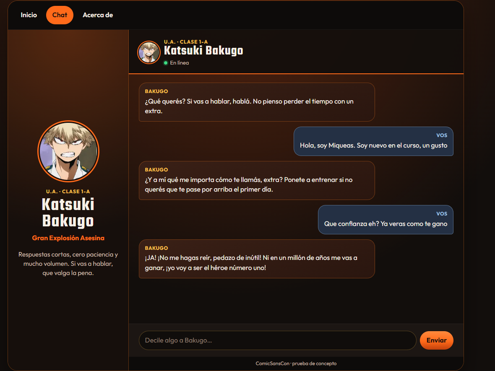

# Charlando con Bakugo

## Link al Deploy

| |
| --- |
| [https://charlandoconbakugo.vercel.app/home](https://charlandoconbakugo.vercel.app/home) |

## Contenido

- [El proyecto](#el-proyecto)
- [El personaje](#el-personaje)
- [Qué puedes hacer](#qué-puedes-hacer)
- [Cómo funciona](#cómo-funciona)
- [Estructura del proyecto](#estructura-del-proyecto)
- [Tecnologías](#tecnologías)
- [Instalación local](#instalación-local)
- [Pruebas](#pruebas)
- [Despliegue en Vercel](#despliegue-en-vercel)
- [Capturas](#capturas)

## El proyecto

Charlando con Bakugo es una prueba de concepto para ComicSansCon, una agencia que arma experiencias interactivas para fans de series, películas y videojuegos. La aplicación permite tener una conversación con Katsuki Bakugo, de My Hero Academia, y sirve para ver si la idea se sostiene antes de ampliarla.

Es un proyecto personal y educativo. No es oficial ni está afiliado con los titulares de My Hero Academia.

[↑ Volver al índice](#contenido)

## El personaje

Katsuki Bakugo es alumno de la Clase 1-A de la U.A. Su quirk es Explosión y su nombre de héroe es Dynamight, también llamado Dios de la gran explosión asesina. Habla en español argentino: competitivo, impaciente y con frases cortas. Puede tratar al otro de "extra" o "inútil", sin insultos graves ni amenazas.

No es un asistente amable. Si alguien insiste con algo serio, baja un poco la agresividad sin dejar la actitud. Le importan sus compañeros, profesores y amigos, aunque lo esconde. Conoce la U.A., la Clase 1-A, All Might, Izuku Midoriya y su meta de ser el héroe número uno, y contesta como si lo hubiera vivido. Si le preguntan algo de la vida real que no existe en su mundo, lo toma como una pavada y no admite que es un personaje de ficción.

Cada respuesta tiene como máximo dos oraciones. No da discursos, no dice que es una inteligencia artificial y no escribe acotaciones como *grita*. Si el usuario busca acercarse, al principio corta y, a medida que la charla avanza, se ablanda un poco sin perder la personalidad.

[↑ Volver al índice](#contenido)

## Qué puedes hacer

- **Entrar por Inicio:** la portada presenta a Bakugo y un botón para empezar a chatear.
- **Conversar:** el mensaje se envía junto con el historial de esa sesión, así la respuesta tiene en cuenta lo que ya se dijo.
- **Cambiar de sección sin perder la charla:** Inicio, Chat y Acerca de no recargan la página. Los mensajes se mantienen al pasar de una vista a otra y se pierden al refrescar el navegador.
- **Usarla en celular, tablet o escritorio:** el diseño parte del celular y se abre en pantallas más grandes. En escritorio el chat muestra la ficha del personaje al costado.
- **Volver con el navegador:** los botones atrás y adelante respetan las rutas `/home`, `/chat` y `/about`.

[↑ Volver al índice](#contenido)

## Cómo funciona

La interfaz vive en `src/`. Es una SPA hecha con HTML, CSS y módulos de JavaScript. `app.js` resuelve la ruta y dibuja la vista. `chat.js` guarda los mensajes en memoria y los envía con `POST` a `/api/functions`.

Ese endpoint es una función de Vercel, `api/functions.js`. Lee `GEMINI_API_KEY` solo en el servidor y llama a Gemini (`gemini-3.6-flash`). La clave no llega al navegador.

Al desplegar, `npm run build` copia `src/` a `dist/`. `vercel.json` publica esa carpeta y reescribe el resto de las rutas a `index.html`, sin tocar `/api/`.

[↑ Volver al índice](#contenido)

## Estructura del proyecto

```text
.
├── api/
│   └── functions.js          # Función serverless /api/functions
├── capturas/
│   └── chat.png              # Captura del chat
├── scripts/
│   └── copy-static.mjs       # Copia src/ a dist/ para el deploy
├── src/
│   ├── assets/
│   │   └── Bakugo.jpg
│   ├── app.js                # Rutas y vistas de Inicio y Acerca de
│   ├── chat.js               # Conversación y envío a la función
│   ├── index.html
│   ├── styles.css
│   └── utils.js
├── tests/
│   ├── app.test.js
│   └── utils.test.js
├── .env.example
├── package.json
├── vercel.json
└── README.md
```

[↑ Volver al índice](#contenido)

## Tecnologías

- HTML, CSS y JavaScript con módulos ES.
- History API para las rutas de la SPA.
- Node.js y npm.
- API de Gemini para las respuestas del personaje.
- Vercel Functions para ocultar la clave.
- Vitest para las pruebas.

[↑ Volver al índice](#contenido)

## Instalación local

Hace falta Node.js, npm, la Vercel CLI y una clave de Gemini creada en [Google AI Studio](https://aistudio.google.com/apikey).

Cloná el repositorio e instalá las dependencias:

```bash
git clone https://github.com/Miqueas7Pastori/ProyectoM3.git
cd ProyectoM3
npm install
```

Creá `.env` a partir de `.env.example`. En PowerShell:

```powershell
Copy-Item .env.example .env
```

En macOS o Linux:

```bash
cp .env.example .env
```

Abrí `.env` y pegá la clave en `GEMINI_API_KEY`, sin comillas. Después levantá el proyecto con la función incluida:

```bash
npx vercel login
npx vercel dev
```

La primera vez, la CLI pide vincular el proyecto. Cuando arranque, abrí la dirección que muestra, en general [http://localhost:3000](http://localhost:3000). `vercel dev` lee `.env` y ejecuta `/api/functions` en local. Sin eso, el chat no puede responder.

No subas `.env`. El archivo ya está en `.gitignore`.

### Variables de entorno

| Variable | Obligatoria | Descripción |
| --- | --- | --- |
| `GEMINI_API_KEY` | Sí | Clave que usa la función de Vercel para llamar a Gemini. |

[↑ Volver al índice](#contenido)

## Pruebas

```bash
npm test
```

Vitest corre las pruebas de `tests/`. Comprueban el escape de HTML, el armado del historial que se manda a Gemini y la lectura de la respuesta. No usan la clave ni llaman a la API.

[↑ Volver al índice](#contenido)

## Despliegue en Vercel

1. Subí el repositorio a GitHub.
2. En [Vercel](https://vercel.com), importá el proyecto. `vercel.json` ya define el build (`npm run build`) y la carpeta de salida (`dist`).
3. En **Settings → Environment Variables**, creá `GEMINI_API_KEY` con la clave de Gemini. Marcá **Production** y **Preview**.
4. Desplegá. Si agregaste la clave después del primer deploy, hacé **Redeploy**: el sitio que ya estaba publicado no toma variables nuevas.
5. Abrí [https://charlandoconbakugo.vercel.app/home](https://charlandoconbakugo.vercel.app/home) y enviá un mensaje en el chat.

[↑ Volver al índice](#contenido)

## Capturas

Chat en escritorio, con la ficha de Bakugo y una conversación en curso.



[↑ Volver al índice](#contenido)
